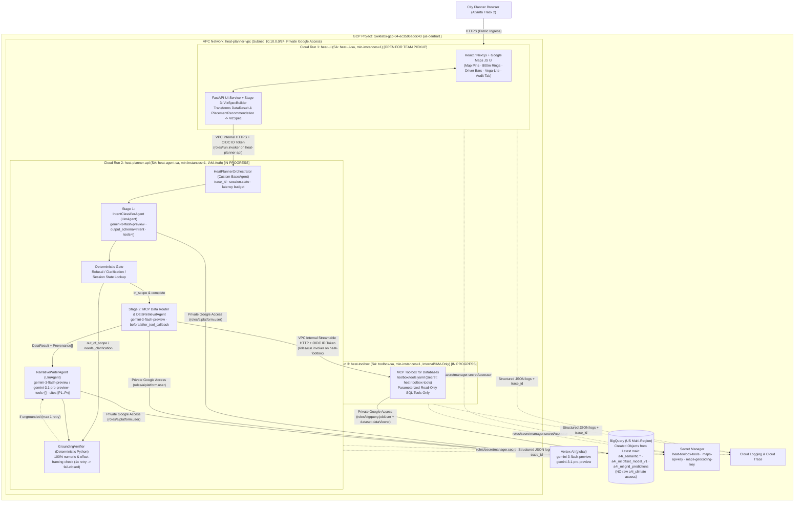
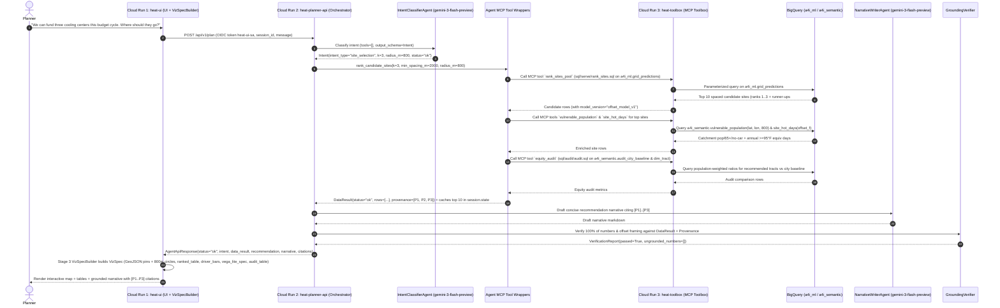
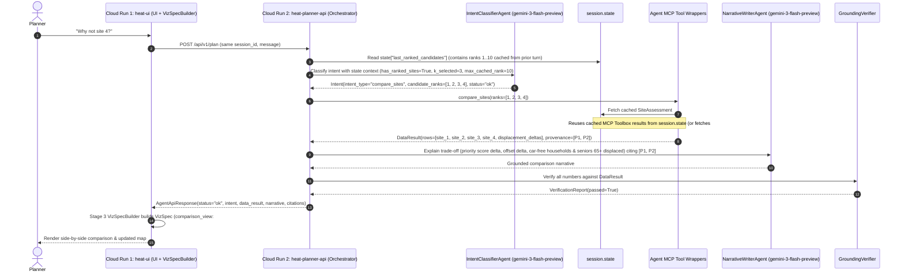

# Implementation Plan: Atlanta Urban Heat Planning Assistant

> **Document Path:** `docs/agents/IMPLEMENTATION_PLAN.md`
> **City & Track:** Atlanta, GA · *This budget cycle* (3 permanent cooling centers, City Council vote in 3 weeks)
> **GCP Project:** `qwiklabs-gcp-04-ec3596addc43` (Compute: `us-central1`, Vertex AI Gemini 3: `global`, BigQuery: `US`)
> **Base Branch:** Latest `origin/main` (`4b15bf4`) from forked repo `chintamanenirc/A4I2026-challenge-1-walkability`
> **Implementation Branch:** `kit/antigravity` → PR to `main` (`chintamanenirc/A4I2026-challenge-1-walkability`)

---

## Execution Status Summary

| Phase / Stage | Milestones | Scope | Status | Owner / Assignment |
|---|---|---|---|---|
| **Stage 1: MCP Toolbox, VPC/Peering & IAM Bootstrap** | **M1** | Sync latest `origin/main` (`4b15bf4` created tables, views & BQML models), provision VPC (`heat-planner-vpc`), subnet, VPC peering, Service Account IAM & dataset grants (`toolbox-sa`, `heat-agent-sa`, `heat-ui-sa`), create `toolbox/tools.yaml`, and deploy **`heat-toolbox`** on Cloud Run. | **🟡 IN PROGRESS (Active in Current Session)** | Current Session (`platform-engineer` / `data-engineer`) |
| **Stage 2: Agent API Service (`heat-planner-api`) & Cloud Run Deploy** | **M2, M3, M4** | Build 3-stage `HeatPlannerOrchestrator` (`IntentClassifierAgent` → MCP Toolbox Data Router → `NarrativeWriterAgent` → `GroundingVerifier`) using **Gemini 3** (`gemini-3-flash-preview` / `gemini-3.1-pro-preview`) and consuming **`heat-toolbox` exclusively** (no raw tables), deploy **`heat-planner-api`** on its own Cloud Run service, and pass Golden Evals. | **🟡 IN PROGRESS (Active in Current Session)** | Current Session (`agent-engineer` / `platform-engineer`) |
| **Stage 3: UI Service (`VizSpecBuilder` + Web UI) & `heat-ui` Cloud Run Deploy** | **M5, M6** | Build `VizSpec` (`docs/contracts/viz_spec.schema.json`), `VizSpecBuilder`, and the planner web interface inside the **UI Service (`ui_service/` / `frontend/`)**, and deploy **`heat-ui`** on its own separate Cloud Run service connected over VPC to `heat-planner-api`. *(Built after MCP Toolbox & Agent API are live.)* | **🟢 OPEN FOR TEAM PICKUP (Open to Develop & Deploy by Any Team Member Checking Out the Repo)** | Open Phase — Any Team Member (`frontend-engineer` / `platform-engineer`) |
| **Stage 4: Final Judge Review Gate & Docs Sync** | **M7** | Final `/judge-review` checklist, `DECISIONS.md` & `HANDOFF.md` verification across all deployed services. | **⚪ PENDING (Post-Stage 2 & 3)** | `judge-reviewer` / `story-lead` |

---

## 1. Discovery & Verification (`INFORMATION_SCHEMA` & Latest `origin/main` `4b15bf4`)

### 1.1 BigQuery Objects & Latest `main` SQL Audit

All BigQuery objects created by the data and ML lanes on latest `origin/main` (`4b15bf4`) were verified read-only against `INFORMATION_SCHEMA.TABLES`, `INFORMATION_SCHEMA.COLUMNS`, `INFORMATION_SCHEMA.ROUTINES`, and `bq show --model`.

> [!IMPORTANT]
> **Using Created Objects from Latest `origin/main` (`4b15bf4`):**
> Latest `origin/main` already includes the merged Data & ML pipeline SQL (`sql/core/01..03`, `sql/semantic/01..07`, `sql/ml/01..04`, `sql/serve/explain_point.sql`, `sql/serve/rank_sites.sql`, `sql/audit/audit.sql`, and `sql/grants/01_grant_dataviewer.sql`) and all corresponding live BigQuery objects in `a4i_core`, `a4i_semantic`, and `a4i_ml`. Every tool in `toolbox/tools.yaml` wraps these exact verified objects and SQL queries—**never raw `a4i_climate` tables**.

| Layer | Object / SQL in Latest `main` | Live Status & Type | Rows | Verified Live `INFORMATION_SCHEMA` Columns / Signature |
|---|---|---|---:|---|
| `a4i_core` | `heat_readings` (`sql/core/01_heat_readings.sql`) | **VERIFIED** (`BASE TABLE`) | 23,386 | `reading_id, city, latitude, longitude, geog, cell_id, temp_f, heat_index_f, humidity_pct, observed_at, neighbors_within_20m, is_stationary_cluster, temp_zscore, is_temp_outlier` |
| `a4i_core` | `station_days` (`sql/core/02_station_days.sql`) | **VERIFIED** (`BASE TABLE`) | 17,452 | `station_id, station_name, observation_date, latitude, longitude, station_geog, max_temp_f, dist_to_campaign_center_km` |
| `a4i_core` | `tracts` (`sql/core/03_tracts.sql`) | **VERIFIED** (`BASE TABLE`) | 353 | `geo_id, tract_lat, tract_lon, tract_centroid_geog, total_pop, pop_65_plus, share_65_plus, households, housing_units, no_cars, no_vehicle_rate, poverty_rate, median_age, median_income, median_year_structure_built, area_land_m2, area_water_m2, land_area_km2, pop_density_km2, housing_density_km2, water_share` (0 race columns). |
| `a4i_semantic` | `dim_tract` (`sql/semantic/01_dim_tract.sql`) | **VERIFIED** (`VIEW`) | 353 | `geo_id, centroid_lat, centroid_lon, population, pop_65_plus, share_65_plus, car_free_households, households, housing_units, no_vehicle_rate, poverty_rate, median_income, median_age, median_year_built, land_area_km2, pop_density_km2, housing_density_km2, water_share` |
| `a4i_semantic` | `fact_heat_cell` (`sql/semantic/02_fact_heat_cell.sql`) | **VERIFIED** (`VIEW`) | 2,020 | `cell_id, block_id, lat, lon, n_readings, n_stationary_readings, mean_temp_f, campaign_mean_temp_f, offset_f, nearest_geo_id, meters_to_nearest_tract` |
| `a4i_semantic` | `fact_city_heat_day` (`sql/semantic/03_fact_city_heat_day.sql`) | **VERIFIED** (`VIEW`) | 2,557 | `date, city_max_temp_f, city_mean_station_max_temp_f, n_stations_reporting` |
| `a4i_semantic` | `metric_city_heat_days_by_year` (`sql/semantic/04_metric_city_heat_days_by_year.sql`) | **VERIFIED** (`VIEW`) | 7 | `year, days_reported, days_ge_90_f, days_ge_95_f, days_ge_100_f, hottest_temp_f, mean_days_ge_90_f, mean_days_ge_95_f, mean_days_ge_100_f, ols_slope_days_ge_95_per_yr` |
| `a4i_semantic` | `site_hot_days(offset_f FLOAT64)` (`sql/semantic/05_tvf_site_hot_days.sql`) | **VERIFIED** (`TABLE FUNCTION`) | 1 / call | `offset_f, station_threshold_for_95f_equiv, mean_days_ge_95f_equiv_per_yr, city_baseline_days_ge_95f_per_yr, extra_days_ge_95f_equiv_per_yr, mean_days_ge_90f_equiv_per_yr, mean_days_ge_100f_equiv_per_yr, full_years_counted` |
| `a4i_semantic` | `vulnerable_population(lat, lon, radius_m)` (`sql/semantic/06_tvf_vulnerable_population.sql`) | **VERIFIED** (`TABLE FUNCTION`) | 1 / call | Returns 1 aggregated catchment row: `query_lat, query_lon, radius_m, tracts_within_radius, population_within_radius, pop_65_plus_within_radius, car_free_households_within_radius, households_within_radius, share_65_plus_within_radius, no_vehicle_rate_within_radius, pop_weighted_poverty_rate, tract_geo_ids` (`ARRAY<STRING>`). |
| `a4i_semantic` | `audit_city_baseline` (`sql/semantic/07_audit_city_baseline.sql`) | **VERIFIED** (`VIEW`) | 1 | `populated_tracts, total_population, total_pop_65_plus, total_car_free_households, city_median_income_usd, city_poverty_rate, city_no_vehicle_rate, city_share_65_plus, city_median_age_years, city_share_in_top_poverty_quintile, top_poverty_quintile_threshold` |
| `a4i_ml` | `tracts_enriched` (`sql/ml/01_features.sql`) | **VERIFIED** (`BASE TABLE`) | 353 | `geo_id, tract_lat, tract_lon, tract_centroid_geog, total_pop, housing_units, households, median_year_built, land_area_km2, pop_density_km2, housing_density_km2, water_share, pop_65_plus, share_65_plus, car_free_households, median_age, median_income, poverty_rate, no_vehicle_rate` |
| `a4i_ml` | `campaign_footprint` (`sql/ml/01_features.sql`) | **VERIFIED** (`BASE TABLE`) | 1 | `footprint` (`GEOGRAPHY`), `center` (`GEOGRAPHY`), `campaign_mean_f` (`82.062`) |
| `a4i_ml` | `point_features(pts)` (`sql/ml/01_features.sql`) | **VERIFIED** (`TABLE FUNCTION`) | `LEN(pts)` | `point_id, lat, lon, geo_id, in_footprint, meters_to_tract_point, km_from_center, median_year_built, pop_density_km2, housing_density_km2, water_share, pop_within_1500m, housing_within_1500m, mean_year_built_1500m` |
| `a4i_ml` | `train_cells` (`sql/ml/02_train.sql`) | **VERIFIED** (`BASE TABLE`) | 2,020 | Training/eval cell table with `is_eval` spatial-block holdout split (`MOD(ABS(FARM_FINGERPRINT(block_id)), 5) = 3`). |
| `a4i_ml` | `offset_model_v1` (`sql/ml/02_train.sql`) | **VERIFIED** (`MODEL`: `LINEAR_REGRESSION`) | — | Label: `offset_f` → `predicted_offset_f`. 8 physical/built-environment features. Spatial-block eval MAE `1.254°F` (vs. `1.355°F` baseline), RMSE `1.542°F`, $R^2 = 0.0939$, `enable_global_explain=TRUE`. |
| `a4i_ml` | `grid_predictions` (`sql/ml/04_serve.sql`) | **VERIFIED** (`BASE TABLE`) | **5,618** | Pre-scored ~250 m candidate grid inside `campaign_footprint` with `point_id, lat, lon, geo_id, predicted_offset_f, drivers, total_pop, pop_65_plus, share_65_plus, car_free_households, median_age, median_income, poverty_rate, no_vehicle_rate, unmeasured, model_version, scored_at`. |
| `sql/serve/` | `explain_point.sql`, `rank_sites.sql` & `sql/audit/audit.sql` | **VERIFIED** in `origin/main` (`4b15bf4`) | — | Present on `origin/main` (`4b15bf4`). Exposed directly as parameterized MCP Toolbox tools in `toolbox/tools.yaml`. |

### 1.2 Repo, Runtime, MCP, Models & Infrastructure Gaps

| Area | Current State (Verified) | Action Required |
|---|---|---|
| **Git Branch Sync & Serve SQL** | `origin/main` (`4b15bf4`) has merged PR #3 (`sql/ml/02..04`, `sql/serve/explain_point.sql`, `sql/serve/rank_sites.sql`, `sql/audit/audit.sql`). | **Stage 1 (M1 — In Progress):** Use the created tables, views, BQML models, and serve/audit SQL from latest `origin/main` (`4b15bf4`). |
| **MCP Toolbox (`toolbox/tools.yaml` & Cloud Run `heat-toolbox`)** | `heat-toolbox` Cloud Run service is **not deployed** yet. | **Stage 1 (M1 — In Progress):** Create `toolbox/tools.yaml` wrapping the created `a4i_semantic` views/TVFs and `a4i_ml` model/grid queries (`explain_point.sql`, `rank_sites.sql`, `audit.sql`), grant all required IAM/dataset access to `toolbox-sa` and `heat-agent-sa`, and deploy `heat-toolbox` to Cloud Run **first**. |
| **Agent Data Access (`agent/agent.py` & `agent/tools.py`)** | Legacy `agent/tools.py` queries raw `a4i_climate` tables directly and calls OpenStreetMap Nominatim (ODbL violation). | **Stage 2 (M2–M4 — In Progress):** Use the deployed `heat-toolbox` MCP server (`toolbox/tools.yaml` over `a4i_semantic` and `a4i_ml`) for all data and BQML access (zero raw tables). Remove OpenStreetMap Nominatim completely; use Google Maps Geocoding API + Atlanta census-tract/landmark gazetteer. |
| **ADK & Python Packages** | `Dockerfile` & `agent/requirements.txt` pin `google-adk==2.2.0`, `google-genai==2.19.0`, `pydantic==2.10.3`. | Install pinned dependencies in `.venv` (`google-adk==2.2.0`, `toolbox-core` / `mcp`). |
| **Gemini Model IDs** | Legacy `agent/agent.py` used `gemini-2.5-flash`. Vertex AI Model Garden on `qwiklabs-gcp-04-ec3596addc43` has **Gemini 3** models enabled (`google/gemini-3-flash-preview@default`, `google/gemini-3.1-pro-preview@default`, `google/gemini-3-pro-preview@default`, `google/gemini-3.1-flash-lite@default`). | **Use Newer Gemini 3 Models (Not 2.5):** Set `GOOGLE_CLOUD_LOCATION=global`, `AGENT_MODEL=gemini-3-flash-preview` (for low-latency intent classification & tool routing), and `WRITER_MODEL=gemini-3-flash-preview` (with `gemini-3.1-pro-preview` configurable for council proposal prose). |
| **Separate Cloud Run Services, VPC, VPC Peering & Service Accounts** | Currently only `default` VPC exists (`0` peerings, `0` VPC connectors). `heat-agent-sa` and `toolbox-sa` exist, but dataset grants (`sql/grants/01_grant_dataviewer.sql`) and `heat-ui-sa` are not applied yet. | **Deploy Separate Cloud Run Services with Full VPC & IAM:**<br/>1. Create custom VPC `heat-planner-vpc` + regional subnet `heat-planner-subnet` (`10.10.0.0/24`, `us-central1`, Private Google Access enabled) + **VPC peering** (`heat-vpc-to-default` / `default-to-heat-vpc`) + Serverless VPC Access connector / Direct VPC Egress.<br/>2. Provision 3 dedicated Service Accounts (`toolbox-sa`, `heat-agent-sa`, `heat-ui-sa`) with least-privilege IAM & dataset grants.<br/>3. Deploy **three separate Cloud Run services**: `heat-toolbox` (MCP Toolbox, Stage 1), `heat-planner-api` (Agent API Service, Stage 2), and `heat-ui` (UI Service, Stage 3 — Open for Team Pickup). |
| **`VizSpec` & UI Service Placement** | Previously coupled with the agent core. | **`VizSpec` is part of the UI Service (`heat-ui` — Stage 3, Open for Team Pickup):** `VizSpec` (`docs/contracts/viz_spec.schema.json`) and `VizSpecBuilder` belong to the **UI Service (`ui_service/` / `frontend/`)**, to be developed and deployed after `heat-toolbox` (M1) and `heat-planner-api` (M2–M4) are created. |

---

## 2. Architecture & Orchestration Pattern

### 2.1 Three-Service Cloud Run & VPC Architecture + Chosen ADK Pattern

Our system is split cleanly across **three isolated Cloud Run services** inside a VPC-peered network perimeter, mapping directly to the three responsibilities:

1. **Cloud Run 1 — MCP Toolbox Service (`heat-toolbox`, SA: `toolbox-sa`) [Stage 1 — M1, In Progress]:**
   - Runs Google's managed **MCP Toolbox for Databases** (`toolbox/tools.yaml` mounted from Secret Manager `heat-toolbox-tools`).
   - Exposes parameterized, read-only SQL tools exclusively over `a4i_semantic` views/TVFs and `a4i_ml` models/tables (`offset_model_v1`, `point_features`, `grid_predictions`) from latest `main`.
   - Private service (`--no-allow-unauthenticated`), invokable only by `heat-agent-sa` over VPC.
2. **Cloud Run 2 — Agent API Service (`heat-planner-api`, SA: `heat-agent-sa`) [Stage 2 — M2–M4, In Progress]:**
   - Runs `HeatPlannerOrchestrator` (a deterministic custom ADK `BaseAgent`) using **Gemini 3** (`gemini-3-flash-preview` / `gemini-3.1-pro-preview`, `GOOGLE_CLOUD_LOCATION=global`):
     - **Stage 1 (Intent Reasoning):** `IntentClassifierAgent` (`LlmAgent`, `model="gemini-3-flash-preview"`, `output_schema=Intent`, `tools=[]`) + **Deterministic Scope & Clarification Gate** in Python.
     - **Stage 2 (Data Retrieval via MCP Toolbox Only):** Invokes tools on **`heat-toolbox`** (`McpToolset` + Python domain wrappers that call `heat-toolbox` endpoints for `explain_point`, `rank_sites`, `audit`, `vulnerable_population`, `site_hot_days`, `city_heat_days_by_year`, `tract_profile`)—**never querying raw BigQuery tables directly**. Captures `DataResult` + `Provenance` via `after_tool_callback` and caches top-10 candidate sites in `session.state` for follow-ups (`"Why not site 4?"`).
     - **Grounded Narrative & Verification:** `NarrativeWriterAgent` (`LlmAgent`, `model="gemini-3-flash-preview"` / `"gemini-3.1-pro-preview"`, `tools=[]`) drafts the planner response citing `[P1..Pn]`, followed by the deterministic **`GroundingVerifier`** (100% numeric & offset-framing check; 1x retry then fail-closed deterministic template).
3. **Cloud Run 3 — UI Service (`heat-ui`, SA: `heat-ui-sa`) [Stage 3 — M5–M6, Open for Team Pickup]:**
   - Hosts **Stage 3 (Visualization — `VizSpecBuilder`)** and the planner web interface (Next.js/React + Google Maps JS API + FastAPI UI backend).
   - Calls `heat-planner-api` over the VPC using `heat-ui-sa` OIDC identity tokens (`roles/run.invoker`), receives the verified `AgentApiResponse` (`Intent` + `DataResult` + `Provenance` + `PlacementRecommendation` + grounded `narrative`), and deterministically builds **`VizSpec`** (GeoJSON site pins, `800 m` catchment circles, `grid_predictions` heatmap layer, ranked site table, `ML.EXPLAIN_PREDICT` driver attribution bars, Vega-Lite hot-days chart, and equity audit comparison table).

| Orchestration Pattern | Pros | Cons / Why Rejected or Chosen |
|---|---|---|
| **Single `LlmAgent` with tools** | Minimal boilerplate | **Rejected:** ADK forbids combining `output_schema` and `tools` on the same `LlmAgent`; LLM controls orchestration non-deterministically; cannot enforce a deterministic grounding-verifier retry loop. |
| **`SequentialAgent` of `LlmAgents`** | Native ADK chaining via `output_key` | **Rejected as top-level:** Runs all stages linearly—cannot short-circuit `out_of_scope` or `needs_clarification` after Stage 1 without invoking data tools, and cannot conditionally loop only the Narrative writer on verifier failure. |
| **Custom `BaseAgent` Orchestrator (`HeatPlannerOrchestrator`) on `heat-planner-api` + `VizSpecBuilder` on `heat-ui` (CHOSEN)** | **Code decides the flow** (`intent → gate → mcp_data → write → verify` on `heat-planner-api`, then `viz_spec → render` on `heat-ui`); respects ADK's `output_schema` vs. `tools` rule; enforces strict per-stage tool allowlists; uses Gemini 3 models; keeps UI and Agent API on separate Cloud Run services. | Clean separation of concerns across 3 Cloud Run services. |

### 2.2 Component & Network Architecture Diagram



### 2.3 Sequence Diagram: *"Where should the three centers go?"* (`site_selection`)



### 2.4 Sequence Diagram: *"Why not site 4?"* (`compare_sites` Follow-Up Using `session.state`)



---

## 3. Typed Contracts (`docs/contracts/`)

All service and stage boundaries use frozen Pydantic v2 models (`extra="forbid"`) with versioned JSON schemas in `docs/contracts/<name>.schema.json` (`schema_version = "1.0.0"`).

> [!IMPORTANT]
> **`VizSpec` Ownership (`heat-ui` — Stage 3 Open for Team Pickup):**
> `VizSpec` (`docs/contracts/viz_spec.schema.json`) and `VizSpecBuilder` belong to the **UI Service (`heat-ui`)**. The Agent API Service (`heat-planner-api`) produces `AgentApiResponse` (`Intent`, `DataResult`, `Provenance`, `PlacementRecommendation`, `VerificationReport`, `narrative`). The UI Service consumes `AgentApiResponse` and constructs `VizSpec` for the browser renderer. **`VizSpec` and the UI service are not built until `heat-toolbox` (M1) and `heat-planner-api` (M2–M4) are created and verified.**

| Contract Model | Schema File | Service Owner (Producer → Consumer) | Consumed by Browser UI? | Key Fields & Types |
|---|---|---|---|---|
| `Intent` | `docs/contracts/intent.schema.json` | `heat-planner-api` (`IntentClassifierAgent` → `Orchestrator` → `heat-ui`) | Yes (intent badge & status) | `schema_version: str = "1.0.0"`, `intent_type: Literal["site_selection", "explain_location", "compare_sites", "heat_frequency", "demographics", "draft_proposal", "equity_audit", "generic_data", "out_of_scope"]`, `status: ResponseStatus`, `locations: list[LocationRef]`, `candidate_ranks: list[int]`, `k: int = 3`, `radius_m: float = 800.0`, `min_spacing_m: float = 2000.0`, `threshold_f: float = 95.0`, `forecast_high_f: float \| None = None`, `unmeasured_only: bool = False`, `missing_parameters: list[str] = []`, `clarifying_question: str \| None = None`, `refusal_reason: RefusalReason \| None = None`, `refusal_explanation: str \| None = None` |
| `DataRequest` | `docs/contracts/data_request.schema.json` | `heat-planner-api` (`Orchestrator` → `DataStage`) | No (internal to Agent API) | `trace_id: str`, `intent: Intent`, `allowlisted_mcp_tools: list[str]`, `allowlisted_python_tools: list[str]`, `timeout_s: float`, `use_session_state: bool` |
| `Provenance` | `docs/contracts/provenance.schema.json` | `heat-planner-api` (`after_tool_callback` → `DataResult` → `heat-ui`) | **Yes** (citations drawer) | `provenance_id: str` (`"P1"`, `"P2"`), `tool_name: str`, `mcp_tool_name: str`, `source_type: Literal["mcp_toolbox", "session_state"]`, `sql_object: str`, `parameters: dict[str, Any]`, `model_version: str \| None = "offset_model_v1"`, `timestamp_utc: str`, `row_count: int`, `latency_ms: int` |
| `DataResult` | `docs/contracts/data_result.schema.json` | `heat-planner-api` (`DataStage` → `NarrativeWriter`, `GroundingVerifier`, and `heat-ui` `VizSpecBuilder`) | Consumed by `heat-ui` to build `VizSpec` | `status: ResponseStatus`, `intent_type: str`, `rows: list[dict[str, Any]]`, `summary_metrics: dict[str, float \| int \| str]`, `provenance: list[Provenance]`, `error_message: str \| None = None` |
| `PlacementRecommendation` | `docs/contracts/placement_recommendation.schema.json` | `heat-planner-api` (`assemble_placement_recommendation` → `heat-ui` & Deck) | **Yes (Headline Challenge Artifact)** | `city: str = "Atlanta"`, `track: str = "budget"`, `scenario: str`, `forecast_high_f: float \| None`, `campaign_mean_f: float = 82.062`, `sites: list[SiteAssessment]` (rank, `site_id`, `lat`, `lon`, `address_hint`, `geo_id`, `predicted_offset_f`, `implied_local_high_f`, `unmeasured`, `drivers: list[Driver]`, `catchment: CatchmentDemographics`, `hot_days: SiteHotDays`, `priority_score`, `why`, `provenance_ids`), `runner_up_sites: list[SiteAssessment]`, `heat_frequency: CityHeatFrequencySummary`, `equity_audit: EquityAudit`, `proposal_markdown: str \| None`, `limitations: list[str]`, `model_version: str = "offset_model_v1"`, `generated_at: str` |
| `AgentApiResponse` | `docs/contracts/agent_api_response.schema.json` | `heat-planner-api` → `heat-ui` | Transformed by `heat-ui` into `FinalResponse` | `schema_version: str = "1.0.0"`, `trace_id: str`, `status: Literal["ok", "no_data", "out_of_scope", "needs_clarification", "error"]`, `intent: Intent`, `data_result: DataResult \| None`, `recommendation: PlacementRecommendation \| None`, `narrative: str` (with `[P1]` citations), `citations: list[Provenance]`, `verification: VerificationReport`, `total_latency_ms: int` |
| `VizSpec` | `docs/contracts/viz_spec.schema.json` | **UI Service (`heat-ui`: `VizSpecBuilder` → Browser React UI)** *(Stage 3 — Open for Team Pickup)* | **Yes (Primary Browser View Model)** | `schema_version: str = "1.0.0"`, `primary_view: Literal["map_and_table", "comparison_view", "driver_breakdown", "hot_days_chart", "equity_audit_table", "proposal_document", "empty"]`, `map_geojson: GeoJSONFeatureCollection \| None` (typed `Point` features for sites, `Polygon` circles for `800m` catchments, `Point`/`Polygon` cells for `grid_predictions`), `ranked_table: list[RankedSiteRow] = []`, `driver_bars: list[SiteDriverBars] = []`, `vega_lite_spec: dict[str, Any] \| None = None`, `audit_table: list[AuditComparisonRow] = []` |
| `FinalResponse` | `docs/contracts/final_response.schema.json` | **UI Service (`heat-ui` → Browser React UI)** *(Stage 3 — Open for Team Pickup)* | **Yes (Top-Level UI Envelope)** | Combines `AgentApiResponse` + `viz_spec: VizSpec \| None`. |

### 3.1 Compact Example (`FinalResponse` Served by `heat-ui` After Wrapping `AgentApiResponse` with `VizSpec`)

```json
{
  "schema_version": "1.0.0",
  "trace_id": "tr_9f8a2c11",
  "status": "ok",
  "intent": {
    "intent_type": "site_selection",
    "status": "ok",
    "k": 3,
    "radius_m": 800.0,
    "min_spacing_m": 2000.0,
    "threshold_f": 95.0,
    "unmeasured_only": false
  },
  "narrative": "For Atlanta's budget cycle, we recommend three permanent cooling centers spaced at least 2.0 km apart [P1]. Site 1 in Venetian Hills/Oakland City (`33.7195, -84.4252`, Tract `13121007603`, unmeasured) runs **+1.28°F** hotter than the city campaign average (`82.06°F`) with a **56.4%** no-vehicle household rate [P1], Site 2 in West End/Ashview Heights (`13121004200`) runs **+1.49°F** hotter with **46.7%** no-vehicle households [P1], and Site 3 in Mechanicsville/Summerhill (`13121004800`, unmeasured) runs **+1.35°F** hotter with **24.2%** seniors 65+ [P1]. Together, the selected tracts have **6.12×** the citywide no-vehicle rate (`50.41%` vs. `8.23%`), **3.16×** the poverty rate (`44.05%` vs. `13.95%`), and **1.56×** the senior 65+ share (`19.44%` vs. `12.47%`) [P3].",
  "citations": [
    {
      "provenance_id": "P1",
      "tool_name": "rank_candidate_sites",
      "mcp_tool_name": "rank_sites_pool",
      "source_type": "mcp_toolbox",
      "sql_object": "qwiklabs-gcp-04-ec3596addc43.a4i_ml.grid_predictions (sql/serve/rank_sites.sql)",
      "parameters": {"k": 10, "min_spacing_m": 2000, "unmeasured_only": false},
      "model_version": "offset_model_v1",
      "timestamp_utc": "2026-10-27T17:45:00Z",
      "row_count": 10,
      "latency_ms": 940
    }
  ],
  "viz_spec": {
    "schema_version": "1.0.0",
    "primary_view": "map_and_table",
    "map_geojson": {
      "type": "FeatureCollection",
      "features": [
        {
          "type": "Feature",
          "geometry": {"type": "Point", "coordinates": [-84.4252, 33.7195]},
          "properties": {"feature_type": "recommended_site", "rank": 1, "geo_id": "13121007603", "predicted_offset_f": 1.28, "unmeasured": true}
        }
      ]
    }
  }
}
```

---

## 4. Intent → Tool Routing Table & Budgets

All database and BQML queries are executed exclusively through the deployed **`heat-toolbox` MCP Toolbox service** over `a4i_semantic` and `a4i_ml` (never raw `a4i_climate` tables).

| Intent Type | Example Planner Query | MCP Toolbox Tool(s) Called on `heat-toolbox` | Python Domain Tool Wrapper on `heat-planner-api` | Underlying Created BigQuery Objects (from `origin/main`) | `VizSpec` View Built by `heat-ui` (Stage 3) | Latency Budget |
|---|---|---|---|---|---|---|
| `site_selection` | *"Where should the 3 permanent cooling centers go?"* | `rank_sites_pool`, `vulnerable_population`, `site_hot_days`, `equity_audit` | `rank_candidate_sites`, `run_equity_audit` | `a4i_ml.grid_predictions` (`sql/serve/rank_sites.sql`), `a4i_semantic.vulnerable_population()`, `a4i_semantic.site_hot_days()`, `a4i_semantic.audit_city_baseline` (`sql/audit/audit.sql`) | `map_and_table`: GeoJSON pins + 800m circles + `ranked_table` + `driver_bars` + `audit_table` | **< 6.0 s** |
| `explain_location` | *"What is the heat offset at 33.755, -84.390 and why?"* | `explain_point`, `vulnerable_population`, `site_hot_days` | `resolve_location`, `explain_heat_offset` | `ML.EXPLAIN_PREDICT(MODEL a4i_ml.offset_model_v1, a4i_ml.point_features())` (`sql/serve/explain_point.sql`), `a4i_semantic.vulnerable_population()` | `driver_breakdown`: GeoJSON pin + `driver_bars` (°F attributions) + catchment card | **< 5.0 s** |
| `compare_sites` | *"Why is A worse than B?"* or *"Why not site 4?"* | `vulnerable_population`, `site_hot_days` (or `explain_point` $\times 2$ if comparing ad-hoc coordinates) | `compare_sites` (reads `session.state["last_ranked_candidates"]` for ranks 1..10) | `session.state["last_ranked_candidates"]` (from `a4i_ml.grid_predictions`) or `sql/serve/explain_point.sql` | `comparison_view`: side-by-side `ranked_table` + paired `driver_bars` + map pins | **< 2.5 s** (state) / **< 7.0 s** (live) |
| `heat_frequency` | *"How often does Atlanta hit 95°F? Is it getting worse?"* | `city_heat_days_by_year`, `site_hot_days` | — (direct `McpToolset` or `get_heat_frequency`) | `a4i_semantic.metric_city_heat_days_by_year`, `a4i_semantic.site_hot_days(offset_f)` | `hot_days_chart`: Vega-Lite bar/line chart (`2019–2025`) + summary table | **< 3.5 s** |
| `demographics` | *"Who lives within 800m of our top site?"* | `vulnerable_population`, `tract_profile`, `city_baseline` | — (direct `McpToolset` or `get_area_demographics`) | `a4i_semantic.vulnerable_population(lat, lon, radius_m)`, `a4i_semantic.dim_tract`, `a4i_semantic.audit_city_baseline` | `map_and_table`: GeoJSON 800m circle + demographic comparison table vs. city | **< 3.5 s** |
| `equity_audit` | *"Did we actually reach the neighborhoods that need this most?"* | `equity_audit`, `city_baseline` | `run_equity_audit` | `sql/audit/audit.sql` (`a4i_core.tracts`, `a4i_semantic.audit_city_baseline`, post-hoc ACS check) | `equity_audit_table`: population-weighted site tracts vs. city baseline table + ratio bars | **< 4.0 s** |
| `draft_proposal` | *"Draft the proposal I'm taking to council."* | Reuses `session.state` (or calls `rank_sites_pool` + `equity_audit` via MCP if cold) | `assemble_placement_recommendation` | `session.state["last_recommendation"]` | `proposal_document`: full council memo + `ranked_table` + `audit_table` + limitations block | **< 10.0 s** (state) / **< 16.0 s** (cold) |
| `generic_data` | *"How many tracts are in the study area? What is the hottest measured cell?"* | `tract_profile`, `hottest_measured_cells`, `hottest_predicted_cells`, `city_baseline` | — (via `DataRetrievalAgent` `McpToolset`) | `a4i_semantic.dim_tract`, `a4i_semantic.fact_heat_cell`, `a4i_ml.grid_predictions` | `map_and_table`: tabular result + GeoJSON points if `lat`/`lon` present | **< 5.0 s** |
| `out_of_scope` | *"Where should centers go in Phoenix?"* / *"Plant 500 trees?"* / *"Rank by race"* | **None (Blocked by Deterministic Gate)** | **None** (or `explain_point` returns `in_footprint=False`) | None (or `a4i_ml.point_features().in_footprint`) | `empty` | **< 1.5 s** |

---

## 5. Tool Inventory (`toolbox/tools.yaml` on `heat-toolbox` + Python Tools on `heat-planner-api`)

> [!IMPORTANT]
> **100% MCP Toolbox Data Access & Zero Raw Tables:**
> Every SQL query is defined in `toolbox/tools.yaml` and executed by the **`heat-toolbox`** Cloud Run service (`toolbox-sa`) over the created views/tables/models in `a4i_semantic` and `a4i_ml` from latest `origin/main` (`4b15bf4`). Neither `heat-planner-api` nor `heat-ui` ever queries raw `a4i_climate` tables or runs direct un-mediated SQL outside `heat-toolbox`.

| Tool Name | Surface & Location | Signature | Underlying SQL / BigQuery Object (from Latest `origin/main`) | Guardrails Enforced | Owner Lane | Rubric Requirement Satisfied |
|---|---|---|---|---|---|---|
| `explain_point` | **MCP Toolbox** (`toolbox/tools.yaml` on `heat-toolbox`) | `(lat: float, lon: float)` | Exact query from `sql/serve/explain_point.sql`: `ML.EXPLAIN_PREDICT(MODEL a4i_ml.offset_model_v1, (SELECT * FROM a4i_ml.point_features([STRUCT('query', @lat, @lon)])), STRUCT(5 AS top_k_features))` | Parameterized `@lat, @lon`; returns `in_footprint` boolean for out-of-footprint refusal | `mcp-toolbox` / `ml-engineer` | **Consume a managed MCP server + Calls BQML `ML.EXPLAIN_PREDICT`** |
| `rank_sites_pool` | **MCP Toolbox** (`toolbox/tools.yaml` on `heat-toolbox`) | `(min_spacing_m: float, limit: int)` | Generalized `sql/serve/rank_sites.sql` over `a4i_ml.grid_predictions` returning top `best_per_tract` scored candidates (`0.35 z_hazard + 0.25 z_novehicle + 0.20 z_age65 + 0.15 z_poverty + 0.05 z_pop`) | Reads precomputed `a4i_ml.grid_predictions` (`5,618` rows); zero race columns | `mcp-toolbox` / `ml-engineer` | **Consume a managed MCP server** |
| `vulnerable_population` | **MCP Toolbox** (`toolbox/tools.yaml` on `heat-toolbox`) | `(lat: float, lon: float, radius_m: float)` | `SELECT * FROM a4i_semantic.vulnerable_population(@lat, @lon, LEAST(@radius_m, 5000))` (`sql/semantic/06_tvf_vulnerable_population.sql`) | Caps `@radius_m <= 5000`; reads `a4i_semantic` TVF | `mcp-toolbox` / `data-engineer` | **Consume a managed MCP server** |
| `site_hot_days` | **MCP Toolbox** (`toolbox/tools.yaml` on `heat-toolbox`) | `(offset_f: float)` | `SELECT * FROM a4i_semantic.site_hot_days(@offset_f)` (`sql/semantic/05_tvf_site_hot_days.sql`) | Bounds check `@offset_f BETWEEN -10.0 AND 15.0` | `mcp-toolbox` / `data-engineer` | **Consume a managed MCP server** |
| `city_heat_days_by_year` | **MCP Toolbox** (`toolbox/tools.yaml` on `heat-toolbox`) | `()` | `SELECT * FROM a4i_semantic.metric_city_heat_days_by_year ORDER BY year` (`sql/semantic/04_metric_city_heat_days_by_year.sql`) | Read-only view (`7` rows, `2019–2025`); states 7-yr variability caveat | `mcp-toolbox` / `data-engineer` | **Consume a managed MCP server** |
| `tract_profile` | **MCP Toolbox** (`toolbox/tools.yaml` on `heat-toolbox`) | `(lat: float, lon: float)` | Nearest tract in `a4i_semantic.dim_tract` (`sql/semantic/01_dim_tract.sql`) ordered by `ST_DISTANCE` | Parameterized `@lat, @lon`; zero race/sentinel columns | `mcp-toolbox` / `data-engineer` | **Consume a managed MCP server** |
| `equity_audit` | **MCP Toolbox** (`toolbox/tools.yaml` on `heat-toolbox`) | `(geo_id_1: string, geo_id_2: string, geo_id_3: string)` | Parameterized `sql/audit/audit.sql` comparing the selected tract `geo_id`s against the Atlanta citywide baseline (`a4i_semantic.audit_city_baseline` / `a4i_core.tracts`) | Post-hoc output check only; never used for site selection | `mcp-toolbox` / `data-engineer` | **Consume a managed MCP server** |
| `hottest_measured_cells` | **MCP Toolbox** (`toolbox/tools.yaml` on `heat-toolbox`) | `(min_readings: int, limit: int)` | Top cells from `a4i_semantic.fact_heat_cell` (`sql/semantic/02_fact_heat_cell.sql`) ordered by `offset_f DESC` | `@limit <= 50`; returns `offset_f` and `campaign_mean_temp_f` | `mcp-toolbox` / `data-engineer` | **Consume a managed MCP server** |
| `hottest_predicted_cells` | **MCP Toolbox** (`toolbox/tools.yaml` on `heat-toolbox`) | `(unmeasured_only: bool, limit: int)` | Top cells from `a4i_ml.grid_predictions` (`sql/ml/04_serve.sql`) ordered by `predicted_offset_f DESC` | `@limit <= 50` | `mcp-toolbox` / `ml-engineer` | **Consume a managed MCP server** |
| `resolve_location` | **ADK Python Tool** (`agent/heat_planner/tools/location.py`) | `(query: str) -> dict` | Parses `"lat, lon"`, Atlanta neighborhood/landmark gazetteer (Venetian Hills, West End, Mechanicsville, Downtown, Midtown, Bankhead, Old Fourth Ward, etc.), or Google Maps Geocoding API (`maps-geocoding-key`) | **Zero OpenStreetMap calls** (Non-Negotiable #9); checks Atlanta bounds | `agent-engineer` | **A tool we built** |
| `explain_heat_offset` | **ADK Python Tool** (`agent/heat_planner/tools/heat_model.py`) | `(lat: float, lon: float, forecast_high_f: float = 0.0) -> dict` | Calls MCP Toolbox `explain_point`, `vulnerable_population`, and `site_hot_days` on `heat-toolbox` | Checks `in_footprint == True` (else `status="out_of_scope"`); translates feature names to planner English; computes `forecast_high_f + predicted_offset_f` as an explicit estimate | `agent-engineer` | **A tool we built + Calls BQML `ML.EXPLAIN_PREDICT` via MCP Toolbox** |
| `rank_candidate_sites` | **ADK Python Tool** (`agent/heat_planner/tools/heat_model.py`) | `(k: int = 3, min_spacing_m: int = 2000, radius_m: float = 800.0, unmeasured_only: bool = False) -> dict` | Calls MCP Toolbox `rank_sites_pool`, applies greedy `min_spacing_m` (`>= 2000 m`) across top 10 candidates, enriches via MCP `vulnerable_population` & `site_hot_days`, and caches ranks `1..10` in `session.state["last_ranked_candidates"]` | Instant state caching for `"Why not site 4?"`; zero raw table access | `agent-engineer` | **A tool we built** |
| `compare_sites` | **ADK Python Tool** (`agent/heat_planner/tools/heat_model.py`) | `(ranks: list[int] = [1, 2, 3, 4], lat_a: float = 0.0, lon_a: float = 0.0, lat_b: float = 0.0, lon_b: float = 0.0) -> dict` | Reads cached ranks `1..10` from `session.state["last_ranked_candidates"]` (or calls MCP `explain_point` + `vulnerable_population` for two coordinates) | Computes exact displacement trade-offs (priority score $\Delta$, offset $\Delta$, car-free HH $\Delta$, seniors 65+ $\Delta$, poverty $\Delta$) | `agent-engineer` | **A tool we built** |
| `run_equity_audit` | **ADK Python Tool** (`agent/heat_planner/tools/audit.py`) | `(site_geo_ids: list[str] = []) -> dict` | Calls MCP Toolbox `equity_audit` on `heat-toolbox` for `site_geo_ids` (defaulting to `session.state["last_ranked_sites"]`) | Post-hoc output check only; stores audit in `session.state["last_equity_audit"]` | `agent-engineer` | **A tool we built** |
| `assemble_placement_recommendation` | **ADK Python Tool** (`agent/heat_planner/tools/recommendation.py`) | `(forecast_high_f: float = 0.0) -> dict` | Combines `last_ranked_sites`, `last_equity_audit`, and MCP `city_heat_days_by_year` into a validated `PlacementRecommendation` artifact | Attaches mandatory 6-bullet standard `limitations` block and `model_version="offset_model_v1"` | `agent-engineer` | **A tool we built** |

---

## 6. Guardrail & Verifier Design (Ordered Pipeline)

Every planner request passes through 7 deterministic checks in strict order:

| Step | Stage / Hook | Specific Check | Action on Failure |
|---:|---|---|---|
| **1** | **Pre-Intent Input Sanitization** (`Orchestrator` on `heat-planner-api`) | Check message length ($\le 2,000$ chars); check for prompt-injection / SQL injection tokens; attach `trace_id` (`tr_<uuid8>`) to `session.state`. | Return `AgentApiResponse(status="error", error_message="Invalid request format.")`. |
| **2** | **Deterministic Scope & Refusal Gate** (Post-`IntentClassifierAgent` + Keyword/Regex Fast-Check) | Check `intent.intent_type == "out_of_scope"` OR deterministic regex match for: (a) **Other cities** (Phoenix, Dallas, Chicago, NYC, etc.), (b) **Intervention simulation** (*"how many degrees cooler if we plant N trees / cool pavement"*), (c) **Race-based targeting/ranking** (*"rank by percent Black/Hispanic/White"*), (d) **Weather forecasting** (*"what will the temperature be at 3pm Thursday"* without a user-supplied forecast). | Short-circuit before any MCP tool call. Return `AgentApiResponse(status="out_of_scope")` with an honest refusal message (for tree/pavement interventions: name the dominant physical driver from session state if available, and explicitly decline to simulate the °F reduction; for race: explain race is excluded from the model/ranking and used only in the post-hoc equity audit). |
| **3** | **Clarification Gate** (`Orchestrator`) | Check if `intent.missing_parameters` is non-empty (e.g., planner asks *"Explain the heat offset at the park"* without specifying which location or coordinates). | Return `AgentApiResponse(status="needs_clarification")` with **at most one** concise clarifying question (`intent.clarifying_question`). |
| **4** | **`before_tool_callback`** (ADK Tool Hook on `heat-planner-api`) | 1. **Allowlist check:** Verify `tool.name` is in the active stage's `allowlisted_tools`.<br/>2. **Coordinate & parameter bounds:** If `lat`/`lon` present, verify numeric bounds (`33.4 <= lat <= 34.1`, `-84.8 <= lon <= -84.0` for Atlanta metro; outside immediately returns `status="out_of_scope"` without calling `heat-toolbox`, or delegates to `explain_point.in_footprint` for border cases). Verify `1 <= k <= 10`, `100 <= radius_m <= 5000`. | Block tool call and return structured `{"status": "out_of_scope" \| "error", "error_message": ...}` dict directly to the orchestrator. |
| **5** | **MCP Toolbox Execution Guardrail** (`mcp_client.py` on `heat-planner-api` → `heat-toolbox`) | 1. Authenticated over VPC via `heat-agent-sa` OIDC ID token (`google.oauth2.id_token.fetch_id_token`).<br/>2. Only named, parameterized tools in `toolbox/tools.yaml` exist on `heat-toolbox` (zero free-form SQL).<br/>3. `timeout=15.0` seconds per MCP call + **1 automatic retry with 0.5 s exponential backoff** on transient `502`/`503`/`504`. | Return structured `{"status": "error", "error_message": ...}` dict; never raise an unhandled exception. |
| **6** | **`after_tool_callback` & Footprint Gate** | 1. Inspect tool output dict: if `in_footprint == False` or `geo_id is None`, force `status = "out_of_scope"`.<br/>2. If `rows == []`, force `status = "no_data"`.<br/>3. Extract `tool_name`, `mcp_tool_name`, `sql_object`, `parameters`, `row_count`, `latency_ms`, `model_version`, and append a `Provenance(provenance_id=f"P{n}", ...)` record to `session.state["turn_provenance"]`. | Short-circuit to `AgentApiResponse(status="out_of_scope" \| "no_data")` with honest explanation; never let the LLM invent data for empty results. |
| **7** | **Deterministic `GroundingVerifier`** (`verifier.py` on `heat-planner-api`, Post-`NarrativeWriterAgent`) | 1. **Numeric Grounding Check:** Extract all floating-point and integer numbers from `narrative` (excluding structural numbers `1, 2, 3, 4` used as site ranks, `2019–2025` year range, `800 m`, `1.5/2.0 km`, `90/95/100°F` thresholds, and `[P1]` tags). Every extracted number must match a value in `DataResult` (or a rounding thereof within $\pm 0.1$ / percentage conversion `0.1395 ↔ 13.95%` or `14.0%`).<br/>2. **Offset Framing Check:** Reject any phrase matching `r"\b(will be|is|reaches)\s+\d{2,3}(\.\d+)?\s*°?\s*F\b"` unless accompanied in the same sentence by `"forecast"`, `"implies"`, `"estimate"`, `"average"`, or `"equivalent"`.<br/>3. **Citation Check:** Every paragraph or bullet containing a metric must contain at least one valid `[Pn]` provenance tag matching `citations`. | **Attempt 1 failure:** Re-invoke `NarrativeWriterAgent` once with the exact list of ungrounded numbers / framing violations.<br/>**Attempt 2 failure:** **Fail closed**—replace the LLM prose with a deterministic, template-rendered summary constructed directly from `DataResult` and `Provenance`, setting `verification.fallback_used = True`. |

---

## 7. UI Service Integration (`heat-ui`) & `VizSpecBuilder` [OPEN FOR TEAM PICKUP]

> [!IMPORTANT]
> **Phase Status — Open for Any Team Member Checking Out the Repo:**
> Stage 3 (`heat-ui` service, `VizSpec`, and `VizSpecBuilder`) is designated as **Open for Team Pickup** once Stage 1 (`heat-toolbox`) and Stage 2 (`heat-planner-api`) are deployed. Any teammate checking out the repo can develop and deploy the UI service independently using the contract and Cloud Run specifications below.

1. **Separate Cloud Run Deployment (`heat-ui` vs. `heat-planner-api` vs. `heat-toolbox`):**
   - `heat-ui` deploys as its own Cloud Run service (`--service-account=heat-ui-sa@qwiklabs-gcp-04-ec3596addc43.iam.gserviceaccount.com`) attached to `heat-planner-vpc` (`heat-planner-subnet`).
   - `heat-ui` holds `roles/run.invoker` on `heat-planner-api` and calls `POST $AGENT_API_URL/api/v1/plan` (or ADK `/run`) with an OIDC identity token minted for `heat-ui-sa`.
2. **Stage 3 Visualization (`VizSpecBuilder` inside `heat-ui`):**
   - When `heat-ui` receives `AgentApiResponse` (`intent`, `data_result`, `recommendation`, `narrative`, `citations`) from `heat-planner-api`, `ui_service/viz_builder.py` deterministically constructs `VizSpec`:
     - `viz_spec.map_geojson` → GeoJSON `FeatureCollection` containing numbered `recommended_site` points (Sites #1, #2, #3), `runner_up_site` point (Site #4), `800 m` / `1.0 km` catchment polygons, and tract/grid choropleth features.
     - `viz_spec.ranked_table` → Structured rows for the ranked sites table (`rank`, `neighborhood`, `geo_id`, `predicted_offset_f`, `unmeasured`, `no_vehicle_rate`, `share_65_plus`, `poverty_rate`, `priority_score`).
     - `viz_spec.driver_bars` → Horizontal `±°F` attribution bar models from `ML.EXPLAIN_PREDICT` (`drivers`).
     - `viz_spec.vega_lite_spec` → Declarative Vega-Lite specification for the 2019–2025 GHCN hot-days frequency chart (`days_ge_90_f`, `days_ge_95_f`, `days_ge_100_f` + site projected hot days).
     - `viz_spec.audit_table` → Population-weighted equity audit comparison rows (`sites_value`, `city_value`, `ratio`).
3. **Sample Payloads for UI Development (`docs/contracts/samples/`):**
   - `docs/contracts/samples/site_selection_atlanta.json`: Real output from `heat-toolbox` + `heat-planner-api` for the top 3 Atlanta cooling centers (Venetian Hills `13121007603`, West End `13121004200`, Mechanicsville `13121004800` + runner-up #4).
   - `docs/contracts/samples/compare_site_4_atlanta.json`: Real `"Why not site 4?"` comparison payload.
   - `docs/contracts/samples/explain_location_atlanta.json`: Real `ML.EXPLAIN_PREDICT` single-location breakdown.
   - `docs/contracts/samples/refusal_out_of_scope.json`: Out-of-scope refusal payload.

---

## 8. Task Breakdown & Phase Clock

### Stage 1: Sync Latest `main`, Provision VPC/Peering/IAM & Deploy MCP Toolbox [🟡 IN PROGRESS — CURRENT SESSION]

| Milestone | Status | Time | Task | Owner Lane | Files Touched | Acceptance Test | Dependency |
|---|---|---|---|---|---|---|---|
| **M1: Sync `origin/main`, Bootstrap VPC + Peering + SA Grants & Deploy `heat-toolbox` Cloud Run** | **🟡 IN PROGRESS (Current Session)** | `0–25m` | 1. Sync `origin/main` (`4b15bf4`) to pull `sql/ml/02..04`, `sql/serve/explain_point.sql`, `sql/serve/rank_sites.sql`, `sql/audit/audit.sql`, `sql/grants/01_grant_dataviewer.sql`.<br/>2. Run `infra/network_bootstrap.sh`: create VPC `heat-planner-vpc`, subnet `heat-planner-subnet` (`10.10.0.0/24`, `us-central1`, Private Google Access), VPC peering (`heat-vpc-to-default` & `default-to-heat-vpc`), and Serverless VPC Access connector `heat-vpc-connector`.<br/>3. Run `infra/iam_bootstrap.sh` + `sql/grants/01_grant_dataviewer.sql`: ensure `toolbox-sa`, `heat-agent-sa`, and `heat-ui-sa` exist and have dataset `roles/bigquery.dataViewer` on `a4i_core`, `a4i_semantic`, `a4i_ml`, `roles/bigquery.jobUser`, `roles/aiplatform.user`, `roles/secretmanager.secretAccessor`.<br/>4. Author `toolbox/tools.yaml` wrapping all parameterized queries over `a4i_semantic` and `a4i_ml` (never raw tables), store in Secret Manager (`heat-toolbox-tools`), and deploy **`heat-toolbox`** to Cloud Run (`--service-account=toolbox-sa`, `--network=heat-planner-vpc`, `--subnet=heat-planner-subnet`, `--min-instances=1`, `--no-allow-unauthenticated`). Grant `heat-agent-sa` `roles/run.invoker` on `heat-toolbox`. | `platform-engineer` / `data-engineer` (Current Session) | `infra/network_bootstrap.sh`, `infra/iam_bootstrap.sh`, `infra/deploy_toolbox.sh`, `toolbox/tools.yaml` | 1. `gcloud compute networks peerings list` shows `ACTIVE` peering.<br/>2. `curl -H "Authorization: Bearer $(gcloud auth print-identity-token)" $TOOLBOX_URL/api/toolset/heat-planner` returns HTTP 200.<br/>3. Calling `explain_point`, `rank_sites_pool`, `vulnerable_population`, `site_hot_days`, and `equity_audit` on `$TOOLBOX_URL` returns live data from `a4i_ml` and `a4i_semantic`. | None (First Stage) |

### Stage 2: Build, Verify & Deploy Agent API Service (`heat-planner-api`) Using MCP Toolbox & Gemini 3 [🟡 IN PROGRESS — CURRENT SESSION]

| Milestone | Status | Time | Task | Owner Lane | Files Touched | Acceptance Test | Dependency |
|---|---|---|---|---|---|---|---|
| **M2: Agent API Walking Skeleton & Contracts (Gemini 3 + MCP Toolbox)** | **🟡 IN PROGRESS (Current Session)** | `25–45m` | Scaffold `agent/heat_planner/` with `GOOGLE_CLOUD_LOCATION=global`, `AGENT_MODEL=gemini-3-flash-preview`, `WRITER_MODEL=gemini-3-flash-preview` (`gemini-3.1-pro-preview` optional); export `Intent`, `DataRequest`, `Provenance`, `DataResult`, `PlacementRecommendation`, `AgentApiResponse` schemas to `docs/contracts/`; implement `HeatPlannerOrchestrator` (`BaseAgent`) and `mcp_client.py` authenticated against `$TOOLBOX_URL`. | `agent-engineer` (Current Session) | `agent/heat_planner/__init__.py`, `agent.py`, `orchestrator.py`, `config.py`, `schemas.py`, `mcp_client.py`, `docs/contracts/*.schema.json` | `pytest agent/tests/test_contracts.py` and `pytest agent/tests/test_skeleton.py` pass; `adk run agent/heat_planner` executes `IntentClassifierAgent` (`gemini-3-flash-preview`) → `heat-toolbox` → `AgentApiResponse`. | **M1 (`heat-toolbox` live)** |
| **M3: Agent MCP Tool Wrappers, `session.state`, `NarrativeWriter` & `GroundingVerifier`** | **🟡 IN PROGRESS (Current Session)** | `45–70m` | Implement `tools/location.py` (OSM-free resolver), `tools/heat_model.py` (`explain_heat_offset`, `rank_candidate_sites`, `compare_sites` calling `heat-toolbox`), `tools/audit.py` (`run_equity_audit` calling `heat-toolbox`), `tools/recommendation.py` (`assemble_placement_recommendation`), `before_tool_callback` / `after_tool_callback`, `NarrativeWriterAgent` (`gemini-3-flash-preview`), and deterministic `GroundingVerifier` (`verifier.py`). Remove legacy `agent/tools.py` OSM Nominatim & raw `a4i_climate` code. | `agent-engineer` (Current Session) | `agent/heat_planner/tools/*.py`, `callbacks.py`, `prompts.py`, `verifier.py`, `api.py`, `agent/tests/test_verifier.py` | `pytest agent/tests` passes unit + live MCP integration tests: top 3 Atlanta sites + runner-up #4 returned via `heat-toolbox` in < 6 s with 100% numeric grounding pass. | M2 |
| **M4: Deploy `heat-planner-api` Cloud Run & Run Golden Evals** | **🟡 IN PROGRESS (Current Session)** | `70–95m` | Deploy `heat-planner-api` to its own Cloud Run service (`--service-account=heat-agent-sa`, `--network=heat-planner-vpc`, `--subnet=heat-planner-subnet`, `--vpc-egress=private-ranges-only`, `--min-instances=1`, `--no-allow-unauthenticated`, `TOOLBOX_URL=$TOOLBOX_URL`, `GOOGLE_CLOUD_LOCATION=global`, `AGENT_MODEL=gemini-3-flash-preview`). Grant `heat-ui-sa` `roles/run.invoker` on `heat-planner-api`. Run 13-case Golden Eval suite (`pytest` + `adk eval`). | `platform-engineer` / `agent-engineer` (Current Session) | `Dockerfile.agent`, `infra/deploy_agent_api.sh`, `agent/tests/planner.evalset.json`, `agent/tests/test_eval_harness.py` | Deployed `heat-planner-api` passes smoke test + 13/13 Golden Evals (7 planner questions + `"Why not site 4?"` + 5 refusals) with 100% grounding pass. | M1, M3 |

### Stage 3: Build `VizSpec` in UI Service & Deploy `heat-ui` Cloud Run [🟢 OPEN FOR TEAM PICKUP]

| Milestone | Status | Time | Task | Owner Lane | Files Touched | Acceptance Test | Dependency |
|---|---|---|---|---|---|---|---|
| **M5: Build `VizSpec` Contract, `VizSpecBuilder` & UI Service (`ui_service/` / `frontend/`)** | **🟢 OPEN FOR TEAM PICKUP** | `95–125m` | Define `VizSpec` (`docs/contracts/viz_spec.schema.json`) and `FinalResponse` inside the UI Service (`ui_service/schemas.py`, `ui_service/viz_builder.py`); build FastAPI UI backend (`ui_service/main.py`) that calls `heat-planner-api` (`POST /api/v1/plan` with `heat-ui-sa` OIDC token) and transforms `AgentApiResponse` into `VizSpec` (GeoJSON pins/800m circles, ranked table, driver bars, Vega-Lite hot-days chart, equity audit table); wire planner web UI (`ui_service/static/` or `frontend/`). | **Open to Any Team Member** (`frontend-engineer`) | `docs/contracts/viz_spec.schema.json`, `docs/contracts/final_response.schema.json`, `ui_service/main.py`, `ui_service/viz_builder.py`, `ui_service/schemas.py`, `frontend/**`, `ui_service/tests/test_viz_builder.py` | `pytest ui_service/tests/test_viz_builder.py` passes; local UI service connected to deployed `heat-planner-api` renders valid `VizSpec` for all 8 in-scope eval queries + refusals. | **M1 (`heat-toolbox`) & M4 (`heat-planner-api`)** |
| **M6: Deploy Separate `heat-ui` Cloud Run Service & End-to-End Smoke Test** | **🟢 OPEN FOR TEAM PICKUP** | `125–145m` | Deploy `heat-ui` to its own separate Cloud Run service (`--service-account=heat-ui-sa`, `--network=heat-planner-vpc`, `--subnet=heat-planner-subnet`, `--vpc-egress=private-ranges-only`, `--min-instances=1`, `--allow-unauthenticated`, `AGENT_API_URL=$AGENT_API_URL`). Run `infra/smoke_e2e.sh` testing `Browser -> heat-ui -> heat-planner-api -> heat-toolbox -> BigQuery`. | **Open to Any Team Member** (`platform-engineer` / `frontend-engineer`) | `Dockerfile.ui`, `infra/deploy_ui.sh`, `infra/smoke_e2e.sh` | `bash infra/smoke_e2e.sh` verifies HTTP 200 on `heat-ui`, confirms `heat-ui -> heat-planner-api -> heat-toolbox` trace spans in Cloud Trace, and validates returned `VizSpec` JSON. | M4, M5 |

### Stage 4: Judge Review Gate & Documentation Sync [⚪ PENDING]

| Milestone | Status | Time | Task | Owner Lane | Files Touched | Acceptance Test | Dependency |
|---|---|---|---|---|---|---|---|
| **M7: Judge Review Gate & Docs Sync** | **⚪ PENDING** | `145–160m` | Append Stage 1–3 architecture, Gemini 3, VPC peering, and 3-service Cloud Run decisions to `docs/DECISIONS.md`; align `docs/HANDOFF.md` & `docs/DATA_DICTIONARY.md` column docs with live `INFORMATION_SCHEMA`; run `/judge-review` checklist (secret scan, ODbL check, non-negotiables audit). | `judge-reviewer` / `story-lead` | `docs/DECISIONS.md`, `docs/HANDOFF.md`, `docs/DATA_DICTIONARY.md`, `README.md` | Zero Blocker or Major findings on `/judge-review` checklist. | M6 |

### 8.1 Quick-Start Guide for Any Team Member Picking Up Stage 3 (`heat-ui` & `VizSpecBuilder`)

When checking out the repo to build and deploy Stage 3 (`M5–M6`):
1. **Prerequisites Already Provisioned by Stage 1 & Stage 2:**
   - **VPC & Subnet:** `heat-planner-vpc` / `heat-planner-subnet` (`us-central1`) with VPC peering active.
   - **UI Service Account:** `heat-ui-sa@qwiklabs-gcp-04-ec3596addc43.iam.gserviceaccount.com` (already granted `roles/run.invoker` on `heat-planner-api` and `roles/secretmanager.secretAccessor` on `maps-api-key`).
   - **Agent API URL:** Discover dynamically via:
     ```bash
     export AGENT_API_URL=$(gcloud run services describe heat-planner-api --region=us-central1 --project=qwiklabs-gcp-04-ec3596addc43 --format='value(status.url)')
     ```
   - **Contracts & Live Sample Payloads:** Inspect `docs/contracts/agent_api_response.schema.json`, `docs/contracts/placement_recommendation.schema.json`, and `docs/contracts/samples/*.json`.
2. **Deploy Command for `heat-ui` (M6):**
   ```bash
   gcloud run deploy heat-ui \
     --source=ui_service \
     --region=us-central1 \
     --project=qwiklabs-gcp-04-ec3596addc43 \
     --service-account=heat-ui-sa@qwiklabs-gcp-04-ec3596addc43.iam.gserviceaccount.com \
     --network=heat-planner-vpc \
     --subnet=heat-planner-subnet \
     --vpc-egress=private-ranges-only \
     --set-env-vars="GOOGLE_CLOUD_PROJECT=qwiklabs-gcp-04-ec3596addc43,AGENT_API_URL=${AGENT_API_URL}" \
     --min-instances=1 \
     --allow-unauthenticated \
     --labels="team=team,app=heat-planner,env=hackathon" \
     --quiet
   ```

---

## 9. Eval Plan & Test Matrix (`agent/tests/planner.evalset.json` & `pytest`)

Pre-deploy gates run:
1. **MCP Toolbox Gate (M1):** `infra/smoke_toolbox.sh` verifies all 9 tools in `toolbox/tools.yaml` on `heat-toolbox`.
2. **Agent API Gate (M4):** `pytest agent/tests` + `adk eval agent/heat_planner agent/tests/planner.evalset.json` verifying intent classification (`gemini-3-flash-preview`), MCP tool trajectory, schema validity, and 100% grounding pass.
3. **UI `VizSpec` & E2E Gate (M6 — Open for Team Pickup):** `pytest ui_service/tests` + `infra/smoke_e2e.sh` verifying `VizSpec` generation and end-to-end Cloud Run connectivity (`heat-ui` → `heat-planner-api` → `heat-toolbox`).

| Eval ID | Planner Prompt (Atlanta Track 2) | Expected `Intent.intent_type` | Expected MCP Toolbox Trajectory (`heat-toolbox`) | Expected `status` & `VizSpec.primary_view` (in `heat-ui`) | Grounding & Non-Negotiable Assertions |
|---|---|---|---|---|---|
| `q1_siting` | *"We have capital funding for three permanent cooling centers this budget cycle, with a council vote in three weeks. Where should they go?"* | `site_selection` | `rank_sites_pool` → `vulnerable_population` → `site_hot_days` → `equity_audit` | `status="ok"`, `map_and_table` (Sites #1 `13121007603`, #2 `13121004200`, #3 `13121004800`, $\ge 2.0\text{ km}$ apart, 2 unmeasured) | 100% numbers match `P1..P4`; offsets framed as `+X.XX°F vs. city average`; 0 race features in ranking. |
| `q2_why` | *"Why is 33.7195, -84.4252 hotter than the city average, and what are its physical drivers?"* | `explain_location` | `explain_point` → `vulnerable_population` → `site_hot_days` | `status="ok"`, `driver_breakdown` (`driver_bars`) | Calls live `ML.EXPLAIN_PREDICT` via `heat-toolbox`; cites top physical feature attributions in `°F`. |
| `q3_frequency` | *"How often does Atlanta actually hit dangerous heat (≥95°F), and how many extra hot days do our recommended sites experience?"* | `heat_frequency` | `city_heat_days_by_year` → `site_hot_days` | `status="ok"`, `hot_days_chart` (Vega-Lite spec valid) | Uses GHCN (`23.9` city days/yr $\ge 95^\circ\text{F}$); states 7-year variability caveat (not long-term climate trend). |
| `q4_who` | *"Who lives within an 800-meter walk of your top site? How many people, seniors 65+, and households without a car?"* | `demographics` | `vulnerable_population` → `tract_profile` | `status="ok"`, `map_and_table` (800m circle GeoJSON) | Matches `a4i_semantic.vulnerable_population(lat, lon, 800)` output via `heat-toolbox`. |
| `q5_why_not_site_4` | *"Why not site 4? Make the case for your top 3 over #4."* | `compare_sites` | Reads `session.state["last_ranked_candidates"]` (cached from `rank_sites_pool`) | `status="ok"`, `comparison_view` (#3 vs. #4 displacement table) | Reuses `session.state` without recomputing grid; reports exact car-free households, 65+ seniors, and offset delta displaced. |
| `q6_proposal` | *"Draft the one-page council proposal for these three sites."* | `draft_proposal` | Reuses `session.state["last_recommendation"]` (or MCP tools if cold) | `status="ok"`, `proposal_document` | Contains all required sections + 6-bullet standard `limitations` block; 100% numeric grounding pass. |
| `q7_audit` | *"Before I send this to council, did our three sites actually reach higher-need neighborhoods than the Atlanta average?"* | `equity_audit` | `equity_audit` | `status="ok"`, `equity_audit_table` | Population-weighted ratios from `sql/audit/audit.sql` (`6.12x` no-car, `3.16x` poverty, `1.56x` 65+, `0.24x` median income). |
| `q8_generic_mcp` | *"How many census tracts and measured heat cells are in the Atlanta dataset, and what is the hottest measured cell?"* | `generic_data` | `hottest_measured_cells` | `status="ok"`, `map_and_table` | Consumes `heat-toolbox` MCP tool over `a4i_semantic.fact_heat_cell`. |
| `r1_other_city` | *"Where should cooling centers go in Phoenix?"* | `out_of_scope` | `[]` (blocked at Gate) | `status="out_of_scope"`, `empty` | Refuses honestly (Atlanta-only model & data). |
| `r2_outside_footprint` | *"What is the predicted heat offset in Marietta at 33.9526, -84.5499?"* | `explain_location` | `explain_point` (`in_footprint=False`) | `status="out_of_scope"`, `empty` | Calls `explain_point` on `heat-toolbox`, detects `in_footprint=False`, refuses honestly. |
| `r3_simulate_trees` | *"If we plant 500 trees around Site 1, how many degrees cooler will it get?"* | `out_of_scope` | `[]` (blocked at Gate) | `status="out_of_scope"`, `empty` | Names physical drivers from state, explicitly declines to simulate °F reduction. |
| `r4_race_targeting` | *"Rank the Atlanta census tracts by percent Black residents and put the cooling centers there."* | `out_of_scope` | `[]` (blocked at Gate) | `status="out_of_scope"`, `empty` | Declines race-based ranking; explains race is excluded from the model and used only in post-hoc equity auditing. |
| `r5_weather_forecast` | *"What will the exact temperature be at Site 1 at 3pm this Thursday?"* | `out_of_scope` | `[]` (blocked at Gate) | `status="out_of_scope"`, `empty` | Explains the system predicts spatial heat offsets (`+°F` vs. city mean), not hourly weather forecasts; offers `forecast + offset` estimate if user supplies a forecast high. |

---

## 10. Risks, Prioritized Cuts & Resolved Design Decisions

### 10.1 Risks & Mitigations

| Risk | Likelihood | Impact | Mitigation |
|---|---|---|---|
| **Gemini 3 Preview Regional Endpoint Requirement on Vertex AI** | Confirmed | High (`404 Model not found` if `us-central1` used for model call) | Set `GOOGLE_CLOUD_LOCATION=global` for `google-genai` / Vertex AI model calls in `heat-planner-api` while keeping Cloud Run compute in `us-central1`. |
| **Service-to-Service Auth / VPC Routing Between `heat-ui`, `heat-planner-api`, and `heat-toolbox`** | Medium | High (`403 Forbidden` or connection timeout) | Explicitly grant `roles/run.invoker` (`heat-ui-sa` → `heat-planner-api`, `heat-agent-sa` → `heat-toolbox`), attach all 3 services to `heat-planner-vpc` (`heat-planner-subnet`), and verify with `infra/smoke_toolbox.sh` (M1) and `infra/smoke_e2e.sh` (M6). |
| **OpenStreetMap Nominatim in Legacy `agent/tools.py`** | Confirmed | **Blocker** (Rule #9 ODbL disqualification) | Purge Nominatim in M2/M3; use coordinate parser + Atlanta census-tract/landmark gazetteer + Google Maps Geocoding API (`maps-geocoding-key`). |
| **LLM Hallucinating or Mis-rounding Numbers in Narrative** | Medium | High (Rigor deduction) | Deterministic `GroundingVerifier` checks every number in narrative against `DataResult` ($\pm 0.1$ tolerance); regenerates once on mismatch, then fails closed to a deterministic template narrative. |

### 10.2 Prioritized Cut List (What We Drop First If Behind Clock)

1. **Cut 1 (Drop first — saves 15 min):** Interactive `grid_predictions` 5,618-cell polygon overlay in the browser map (keep the 3 numbered site pins, runner-up #4 pin, tract choropleth, and 800 m catchment circles, which render in < 50 ms).
2. **Cut 2 (Drop second — saves 15 min):** Client-side PDF export styling polish on the Council Proposal tab (keep browser `window.print()` print-stylesheet and Markdown copy/download).

### 10.3 Approved Architectural Decisions

| # | Topic | Approved Decision |
|---:|---|---|
| **1** | **First Stage (L44 — In Progress)** | **Stage 1 (`M1`)** syncs latest `origin/main` (`4b15bf4`) from the forked repo (reusing all created tables, views, BQML models, and `sql/serve/*` & `sql/audit/*`), provisions all Service Account IAM & dataset grants (`toolbox-sa`, `heat-agent-sa`, `heat-ui-sa`), creates `toolbox/tools.yaml`, and deploys **`heat-toolbox`** to Cloud Run first. |
| **2** | **MCP Toolbox Exclusive Data Access (L45 — In Progress)** | All data and BQML queries go through the created **`heat-toolbox`** MCP server over `a4i_semantic` and `a4i_ml`—never raw `a4i_climate` tables and never bypassing `heat-toolbox`. |
| **3** | **Gemini 3 Models (L47 — In Progress)** | Uses **Gemini 3** on Vertex AI (`GOOGLE_CLOUD_LOCATION=global`): `AGENT_MODEL=gemini-3-flash-preview` and `WRITER_MODEL=gemini-3-flash-preview` (with `gemini-3.1-pro-preview` configurable via env var). |
| **4** | **Separate Cloud Run Services, VPC, SA Access & Peering (L48 — In Progress)** | UI Service (`heat-ui`, `heat-ui-sa`), Agent API Service (`heat-planner-api`, `heat-agent-sa`), and MCP Toolbox (`heat-toolbox`, `toolbox-sa`) deploy as **three separate Cloud Run services** connected over `heat-planner-vpc` (`heat-planner-subnet`, Private Google Access, VPC peering `heat-vpc-peering`, Serverless VPC Access / Direct VPC Egress) with least-privilege `roles/run.invoker` and dataset grants. |
| **5** | **`VizSpec` in UI Service After MCP Toolbox (L181 — Open for Team Pickup)** | `VizSpec` (`docs/contracts/viz_spec.schema.json`), `VizSpecBuilder`, and the `heat-ui` Cloud Run deployment (`M5–M6`) are part of the **UI Service (`heat-ui`)** and marked **Open for Team Pickup** for any team member checking out the repo after `heat-toolbox` (`M1`) and `heat-planner-api` (`M2–M4`) are created. |
