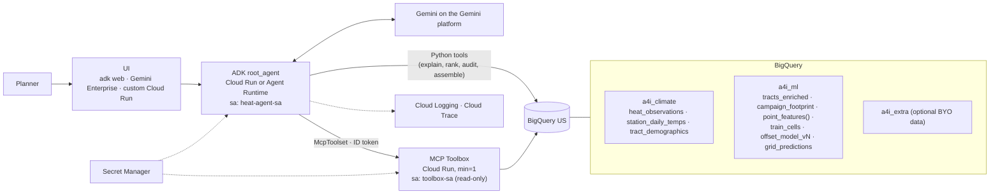

# Architecture: Heat Planning Assistant

## Context

One city, one planner, one decision on a deadline. The system answers *where should heat help
go, and why* for places that were never measured, and it says plainly when it can't.

## Components

## Request paths

| Path | Latency budget | Mechanism |
|---|---|---|
| "Where should 3 centers go?" | < 5 s | `rank_candidate_sites` reads precomputed `grid_predictions` (batch EXPLAIN_PREDICT) |
| "Why is X hotter than Y?" | < 8 s | 2 × live `ML.EXPLAIN_PREDICT` via `point_features()` |
| "How often…?" | < 4 s | GHCN aggregate (Python tool or Toolbox tool) |
| "Draft the proposal" | < 25 s | assemble (deterministic) → Gemini writes from JSON only |

## Contracts (the seams between lanes)

1. `sql/serve/explain_point.sql`: data → agent. Params `@lat, @lon`; output columns frozen.
2. `docs/contracts/placement_recommendation.schema.json`: agent → front end / story.
3. `docs/HANDOFF.md`: table names, model id, URLs. The single place to look.

## Architecture Decision Records

### ADR-001: Predict offset from the campaign mean, not temperature
Status: accepted. All readings share one 1-hour window, so the differences are spatial. Many
campaigns lack timestamps, so a station anchor is unavailable. Consequence: outputs are
relative, and absolute values are always "forecast + offset (estimate)".

### ADR-002: One feature function for training and serving
Status: accepted. `a4i_ml.point_features(ARRAY<STRUCT<point_id, lat, lon>>)` is used by
`train_cells`, `grid_predictions` and `explain_point`. This removes training/serving skew by
construction. Cost: the TVF is recomputed per call. That's acceptable at hackathon scale.

### ADR-003: Spatial-block evaluation split
Status: accepted. Geohash-5 blocks (≈5 km) are hashed to eval at a 20% rate. A random split
over-reports skill because neighbouring cells share heat. We report metrics against a
predict-zero baseline.

### ADR-004: Hazard model separate from vulnerability ranking
Status: accepted. The model uses physical/built-environment features only. Demographics weight
the ranking per track (risk = hazard × exposure × vulnerability). Attributions stay
physical and defensible, and race is never an input. The equity audit checks the output.

### ADR-005: Batch + online serving
Status: accepted. Ranking reads a precomputed ~250 m grid (cheap, fast, deterministic for the
demo). Ad-hoc locations use live `ML.EXPLAIN_PREDICT`. Model promotion = rebuild grid + config change.

### ADR-006: MCP Toolbox on Cloud Run for curated read-only tools; Python tools for shaped logic
Status: accepted. This satisfies "consume a managed MCP server" with access we control (own SA,
named tools). Logic that needs shaping (attribution translation, spacing, assembly) stays in
tested Python. `min-instances=1` removes cold starts on stage.

### ADR-007: Scripts over Terraform for a 4.5-hour build
Status: accepted for the event. Idempotent `gcloud`/`bq` scripts are faster to write and debug
under time pressure. For a long-lived deployment we would move to Terraform with remote state
and CI (Cloud Build) deploys from `main`.

### ADR-008: Versioned models, never overwritten
Status: accepted. `offset_model_v1`, `_v2`… with `BQML_MODEL_ID` in config. A demo can never
break because a teammate retrained mid-call.

## Security & privacy
No key files (ADC + attached SAs). Least-privilege roles at dataset scope via BigQuery DCL.
Secrets only in Secret Manager. Private Toolbox, invoked by ID token. Aggregate public data
only. No individual-level data, and no race in the model.

## Operability
Structured logs per tool call (tool, bytes, latency). Cloud Trace via `--trace_to_cloud`.
Byte caps on every query. Resource labels for cost attribution. A smoke test after every deploy.
